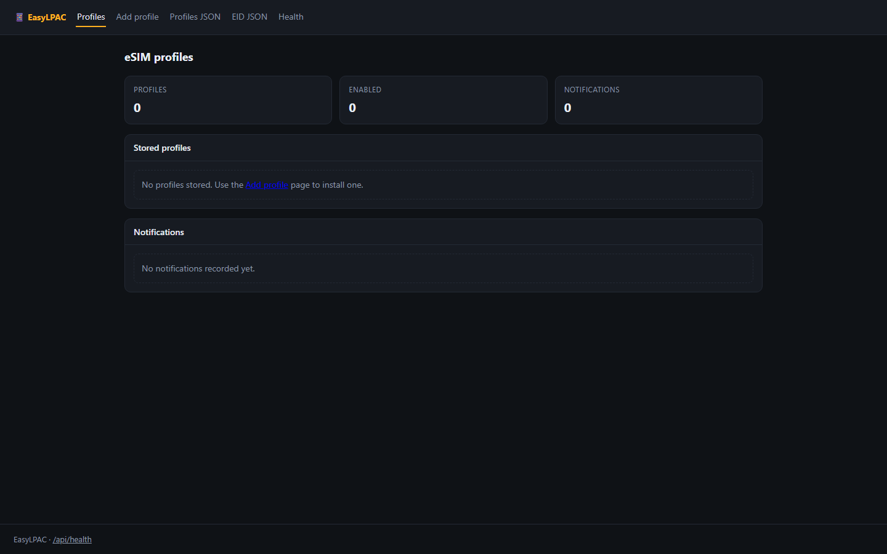
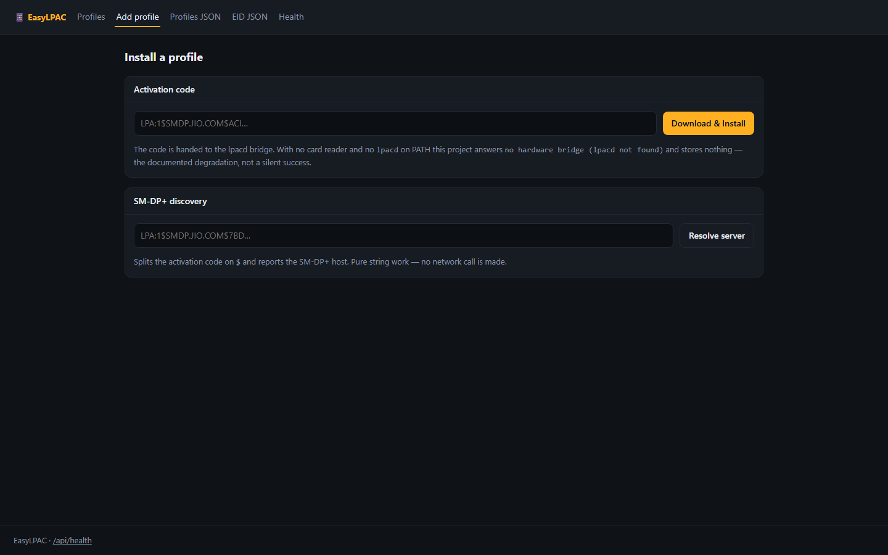
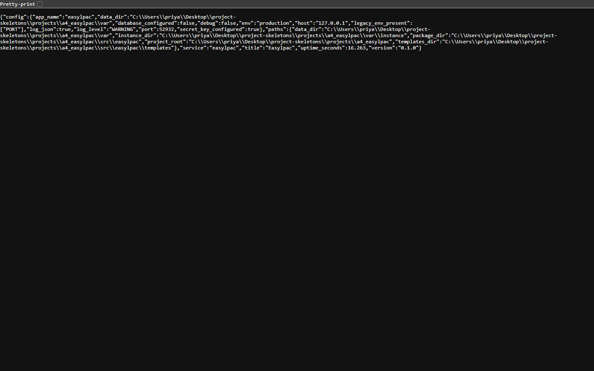

<p align="center">
  
</p>

<h1 align="center">esimkit</h1>

<p align="center"><b>Drive an eSIM card reader over HTTP: discover, install, enable, disable.</b></p>

<p align="center">
  <a href="#quality-gates"></a> <a href="#quality-gates"></a> <a href="#api"></a> <a href="#requirements"></a> <a href="LICENSE"></a>
</p>

esimkit wraps the lpac toolchain in a Flask service and a CLI so an eSIM profile can be discovered, downloaded, installed, enabled, disabled and deleted from a browser or a script — with the EID and the card's profile list exposed as JSON.

---

**Contents** &nbsp;·&nbsp; [Why](#why-this-exists) &nbsp;·&nbsp; [What it does](#what-it-does) &nbsp;·&nbsp; [Quickstart](#quickstart) &nbsp;·&nbsp; [API](#api) &nbsp;·&nbsp; [Screenshots](#screenshots) &nbsp;·&nbsp; [Measured](#measured-not-estimated) &nbsp;·&nbsp; [Architecture](#architecture) &nbsp;·&nbsp; [Quality gates](#quality-gates) &nbsp;·&nbsp; [Deploy](#deploy) &nbsp;·&nbsp; [Limits](#limits-stated-rather-than-hidden)

## Why this exists

The lpac CLI is the right tool and a hostile interface: stateful, chatty, and impossible to drive from a dashboard. esimkit keeps lpac as the only thing that touches the card and puts a small, testable contract in front of it, including an honest error when no reader is attached.

## What it does

| Capability | How it works |
| --- | --- |
| **Profile lifecycle** | List, install from an activation code, enable, disable and delete, one route each. |
| **SM-DP+ discovery** | POST /api/discover resolves a server and returns what it offers before you commit to an install. |
| **EID and reader state** | GET /api/eid reports the card identity; without lpacd on PATH the service says so instead of pretending. |
| **CLI parity** | list, install and enable do the same work without an HTTP client. |

## Quickstart

```sh
git clone https://github.com/scar8969/esimkit.git
cd esimkit
python -m venv .venv && . .venv/bin/activate   # Windows: .venv\Scripts\activate
pip install -e ".[dev]"
python wsgi.py                                 # http://127.0.0.1:8000
```

The same work from the CLI:

```sh
python -m easylpac.cli --help
```

Commands: `list`, `install`, `enable`.

A first request:

```sh
curl -s http://127.0.0.1:8000/api/profiles | head
```

## Requirements

- Python **3.11+** — CI runs 3.11, 3.12 and 3.13.
- Runtime dependencies: `Flask>=3.0`, `Flask-SQLAlchemy>=3.1`, `SQLAlchemy>=2.0`, `PyYAML>=6.0`.
- No JavaScript build step: every page is server-rendered Jinja.

## API

Every route below is in [`openapi/esimkit.yaml`](openapi/esimkit.yaml) and is exercised by the live probe recorded in [`docs/EVIDENCE.md`](docs/EVIDENCE.md).

| Method | Path | What it does |
| --- | --- | --- |
| `GET` | `/api/profiles` | list |
| `POST` | `/api/profiles` | install |
| `POST` | `/api/profiles/<iccid>/enable` | enable |
| `POST` | `/api/profiles/<iccid>/disable` | disable |
| `DELETE` | `/api/profiles/<iccid>` | delete |
| `POST` | `/api/discover` | SM-DP+ discover |
| `GET` | `/api/eid` | EID |
| `GET` | `/api/health` | health |

## Screenshots

Captured from the running service with headless Chromium at 1440×900, one image per page, committed under [`docs/assets/screens/`](docs/assets/screens/).

<table>
<tr>
<td width="50%"><br><sub><code>/add</code> &middot; 35.0 KB</sub></td>
<td width="50%"><br><sub><code>/healthz</code> &middot; 8.3 KB</sub></td>
</tr>
</table>

<table>
<tr>
<td width="50%"><br><sub><code>/livez</code> &middot; 7.3 KB</sub></td>
<td width="50%"><br><sub><code>/metrics</code> &middot; 14.9 KB</sub></td>
</tr>
</table>

<table>
<tr>
<td width="50%"><br><sub><code>/readyz</code> &middot; 7.7 KB</sub></td>
<td width="50%"><br><sub><code>/version</code> &middot; 26.1 KB</sub></td>
</tr>
</table>

## Measured, not estimated

These numbers were produced on this checkout by `pytest --cov` and by booting `wsgi.py` and issuing one real GET per documented path. The commands are in [`docs/EVIDENCE.md`](docs/EVIDENCE.md).

| Signal | Value |
| --- | --- |
| Tests | **135 / 135 passed** (16.7 s, exit 0) |
| Line coverage | **100.0%** — 694 of 694 statements |
| Source | 15 files / 1,520 lines |
| Test code | 15 files / 1,341 lines |
| Documented paths | 7 in the spec, 3 GET |
| Live probe | 10 GET requests to the booted app, **10 answered 200** |
| Median latency | **6.9 ms** (single uncached request, dev server) |
| Slowest / fastest | 40.7 ms `/` / 3.0 ms `/version` |
| Bytes served | 10.6 KB across 10 responses |
| Screenshots | 7 captured |

## Architecture

```
esimkit/
├── src/easylpac/
│   ├── http.py                         383  HTTP plumbing for easylpac: correlation ids, access 
│   ├── config.py                       171  Environment-driven configuration for easylpac
│   ├── observability.py                169  Structured logging and request correlation for easyl
│   ├── lpa/api.py                      143  JSON API for eSIM profile management
│   ├── cli.py                          139  lpac - EasyLPAC command line (mirrors lpa/api.py)
│   ├── app.py                          119  Application factory for easylpac
│   ├── errors.py                       108  Typed application errors and their HTTP mapping for 
│   ├── _app.py                         103  Flask application for EasyLPAC
│   ├── paths.py                         55  Filesystem layout for easylpac
│   ├── lpa/bridge.py                    50  The lpacd / pyscard bridge
│   ├── models.py                        44  
│   ├── lpa/smdp.py                      25  SM-DP+ address resolution for activation codes
├── openapi/esimkit.yaml                   the contract of record
├── schema/esimkit.sql                     the DDL
├── tests/                       the suite that has to stay green
├── docs/EVIDENCE.md             the recorded live route walk
├── Dockerfile                   multi-stage build
└── wsgi.py                      entry point
```

The package keeps one shape across the service: `config.py` reads the environment once, `observability.py` emits structured JSON logs carrying a request id, `errors.py` turns exceptions into a single JSON envelope, `models.py` holds the tables, and the `lpa/` package holds the routes.

## Quality gates

| Gate | Command | Threshold |
| --- | --- | --- |
| Suite | `pytest -q` | all green |
| Coverage | `pytest --cov` | floor set in `pyproject.toml` from the measured value |
| Lint | `ruff check src tests` | zero findings |
| Format | `ruff format --check src tests` | zero reformats |
| Types | `mypy src` | zero errors |
| Security | `bandit -c pyproject.toml -r src` | reviewed skip list, no unreviewed finding |
| Live routes | boot `wsgi.py`, one GET per documented path | no 5xx, no undocumented guard |

CI runs the first six on Python 3.11, 3.12 and 3.13 for every push to `main`, plus a container build. See [`.github/workflows/ci.yml`](.github/workflows/ci.yml).

## Deploy

```sh
docker build -t esimkit .
docker run --rm -p 8000:8000 --env-file .env.example esimkit
```

Configuration is environment-only — every variable is documented in [`.env.example`](.env.example), and the service refuses to start with a production secret missing.

## Limits, stated rather than hidden

- Requires a PC/SC reader and lpacd on PATH; the service degrades to a clear "no hardware bridge" error, and no route fabricates a profile.
- Profile writes are not transactional across a card reset — a mid-install failure can leave the card in its previous state.

## License

MIT — see [LICENSE](LICENSE).
