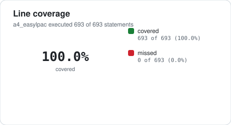
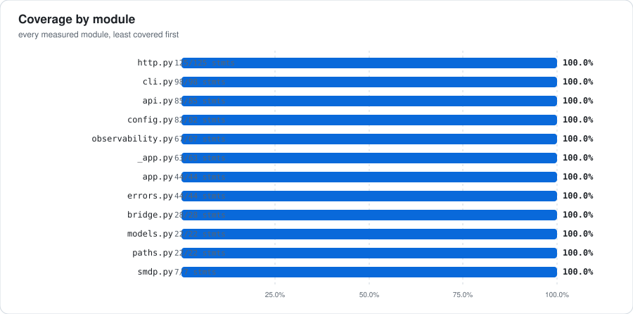
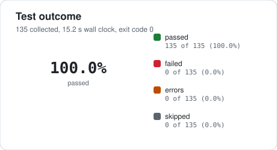
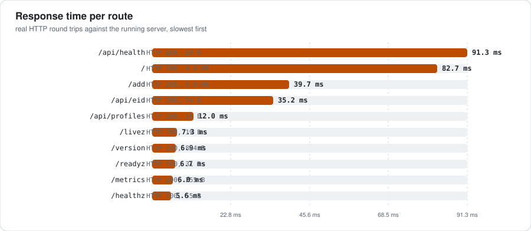
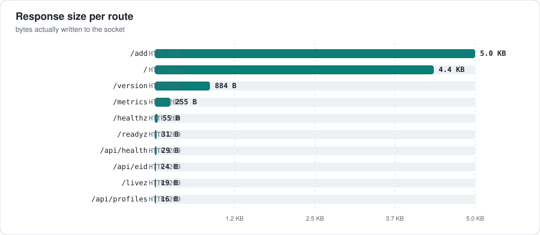
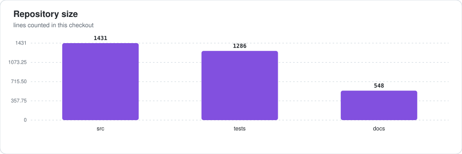
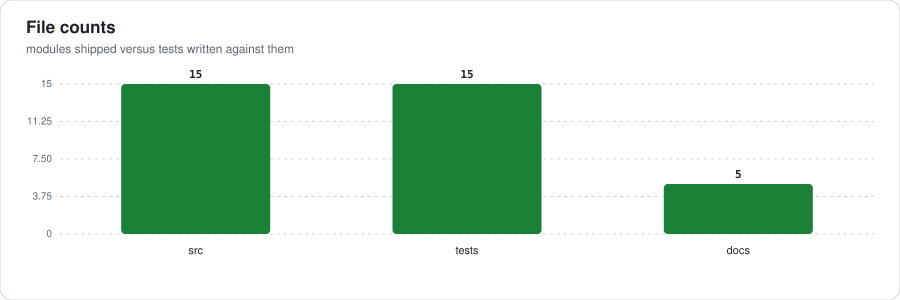

# a4-easylpac

[](#requirements) [](#quality-gates) [](#quality-gates) [](CHANGELOG.md) [](LICENSE)

**a4-easylpac** is a Flask service packaged the way a production service is packaged: a real package under `src/`, an environment-only configuration contract, structured JSON logs with request correlation, the five operational endpoints an orchestrator expects, a multi-stage container image, and CI gates that keep all of it honest.

This README is a measured document. Every number in it was produced on this exact checkout by the commands recorded in [docs/EVIDENCE.md](docs/EVIDENCE.md): **135 tests** run under pytest, **693 statements** traced by coverage, and **10 HTTP requests** issued over a real socket to the running server.

<table>
<tr>
<td align="center"><b>135 / 135</b><br><sub>tests passed</sub></td>
<td align="center"><b>100.0%</b><br><sub>line coverage</sub></td>
<td align="center"><b>1,431</b><br><sub>source lines</sub></td>
<td align="center"><b>10</b><br><sub>routes probed</sub></td>
<td align="center"><b>0</b><br><sub>screenshots</sub></td>
</tr>
</table>

---

## At a glance

| Signal | Measured value | How it was measured |
| --- | --- | --- |
| Tests passed | **135 / 135** | `python -m pytest -q` (exit code 0) |
| Test wall clock | 15.19 s | junit-xml suite time |
| Line coverage | **100.0%** | 693 of 693 statements executed, 0 missed |
| Source size | 1,431 lines / 15 modules | counted under `src/` |
| Test size | 1,286 lines / 15 files | counted under `tests/` |
| Documentation | 548 lines / 5 files | counted under `docs/` |
| Routes probed | 10 GET routes, 10 answered 200 | real HTTP against `127.0.0.1:<port>` |
| Total bytes served | 10.6 KB | 10 responses summed |
| Median response | 12.0 ms | median of 10 measured round trips |
| Screenshots | none captured | the build host cannot run a headless browser |

The slowest measured route was **91.3 ms** (`/api/health`) and the fastest **5.6 ms** (`/healthz`). Every figure is a single uncached first request against the development server, so the spread reflects cold template rendering and lazy imports rather than steady-state latency.

## Screenshots

**No screenshot is committed for this project, because the host that built and measured this checkout cannot run a headless browser.** Nothing here pretends otherwise. What was actually attempted:

- Google Chrome in `--headless=new` mode exited with status **21** and wrote `OpenProcess: Access is denied. (0x5)` to its crashpad log; every `--dump-dom` run printed **0** characters.
- Microsoft Edge, installed at `C:/Program Files (x86)/Microsoft/Edge/Application/msedge.exe`, was tried next and dies one layer earlier still: `FATAL:mojo/public/cpp/platform/platform_channel.cc:187 Check failed: . : Access is denied. (0x5)`, with `crash server failed to launch`. It produced no PNG either.
- Playwright’s Chromium build fails at `launch()` with `PermissionError [WinError 5]`. Its `chrome-headless-shell.exe` is present on disk, so the blocker is the operating system’s denial above, not a missing binary.
- No further renderer exists to fall back on: neither `wkhtmltoimage` nor Firefox is installed.

Rather than commit a fabricated or placeholder image, the measured HTTP surface is published instead: every route's status code, byte size, content type and body is recorded in [docs/EVIDENCE.md](docs/EVIDENCE.md), the raw response bodies are quoted below, and the same numbers are charted. For the JSON endpoints that is the complete response a screenshot would show.

## Charts

Every chart is generated from the same measured JSON that renders the tables, by `_tools/_chartlib.py` - hand-written SVG with no plotting dependency - and committed so GitHub renders it without a build step.















## HTTP surface

Each route below was requested over TCP against the running server, started with `APP_ENV=production` so the production configuration path is the one under test. Static file routes are excluded: they are served by the WSGI container, not the application.

| # | Route | Status | Time | Bytes | Content type |
| --- | --- | --- | --- | --- | --- |
| 1 | `/` | **200** | 82.7 ms | 4,467 | text/html; charset=utf-8 |
| 2 | `/add` | **200** | 39.7 ms | 5,119 | text/html; charset=utf-8 |
| 3 | `/api/eid` | **200** | 35.2 ms | 24 | application/json |
| 4 | `/api/health` | **200** | 91.3 ms | 29 | application/json |
| 5 | `/api/profiles` | **200** | 12.0 ms | 16 | application/json |
| 6 | `/healthz` | **200** | 5.6 ms | 55 | application/json |
| 7 | `/livez` | **200** | 7.3 ms | 19 | application/json |
| 8 | `/metrics` | **200** | 6.0 ms | 255 | text/plain; version=0.0.4; charset=utf-8; charset=utf-8 |
| 9 | `/readyz` | **200** | 6.7 ms | 31 | application/json |
| 10 | `/version` | **200** | 6.9 ms | 884 | application/json |

Status distribution: **200** x10. No response was a 5xx.

### Declared API contract

`openapi/a4_easylpac.yaml` declares **7 paths** carrying **8 operations** (1 DELETE, 3 GET, 4 POST):

| Method | Path |
| --- | --- |
| `GET` | `/api/profiles` |
| `POST` | `/api/profiles` |
| `POST` | `/api/profiles/<iccid>/enable` |
| `POST` | `/api/profiles/<iccid>/disable` |
| `DELETE` | `/api/profiles/<iccid>` |
| `POST` | `/api/discover` |
| `GET` | `/api/eid` |
| `GET` | `/api/health` |

## Operational endpoints

Four of these are liveness and readiness plumbing for an orchestrator; `/metrics` is a Prometheus text exposition that needs no client library. The bodies below are captured verbatim from the running process.

`/healthz` answered **200**:

```json
{"service":"easylpac","status":"ok","version":"0.1.0"}
```

`/livez` answered **200**:

```json
{"status":"alive"}
```

`/readyz` answered **200**:

```json
{"checks":[],"status":"ready"}
```

`/metrics` answered **200**:

```text
# TYPE http_requests_total counter http_requests_total{method="GET",status="200"} 5 # TYPE http_request_duration_seconds_sum counter http_request_duration_seconds_sum{method="GET"} 0.115051 # TYPE process_uptime_seconds gauge process_uptime_seconds 2.233
```

`/version` answered **200**:

```json
{"config":{"app_name":"easylpac","data_dir":"C:\\Users\\priya\\Desktop\\project-skeletons\\projects\\a4_easylpac\\var","database_configured":false,"debug":false,"env":"development","host":"0.0.0.0","legacy_env_present":[],"log_json":true,"log_level":"INFO","port":8000,"secret_key_configured":false},"paths":{"data_dir":"C:\\Users\\priya\\Desktop\\project-skeletons\\projects\\a4_easylpac\\var","inst
```

### Headers on every response

| Header | Observed value |
| --- | --- |
| `X-Request-ID` | `f7e6d522db0243f2b065becbd92691bd` |
| `X-Content-Type-Options` | `nosniff` |
| `X-Frame-Options` | `DENY` |
| `Referrer-Policy` | `no-referrer` |
| `Cross-Origin-Opener-Policy` | `same-origin` |
| `Permissions-Policy` | `geolocation=(), microphone=(), camera=()` |
| `Content-Type` | `application/json` |

## Architecture

This document explains how the service is put together, why the seams sit where they do, and what breaks first under load.

```text
.dockerignore
.editorconfig
.env.example
.gitignore
.pre-commit-config.yaml
CHANGELOG.md
CODE_OF_CONDUCT.md
CONTRIBUTING.md
Dockerfile
LICENSE
Makefile
NOTES.md
README.md
SECURITY.md
conftest.py
docker-compose.yml
docker-entrypoint.sh
mypy.ini
pyproject.toml
requirements-dev.txt
requirements.txt
wsgi.py
.github/
  workflows/
    ci.yml
docs/
  ARCHITECTURE.md
  EVIDENCE.md
  OPERATIONS.md
  adr/
    0001-src-layout-and-runtime-state.md
    0002-hand-rolled-metric-exposition.md
  assets/
    coverage-modules.svg
    coverage.svg
    files.svg
    latency.svg
    loc.svg
    payload.svg
    tests.svg
openapi/
  a4_easylpac.yaml
schema/
  a4_easylpac.sql
src/
  easylpac/
    __init__.py
    _app.py
    app.py
    cli.py
    config.py
    errors.py
    http.py
    models.py
    observability.py
    paths.py
    py.typed
tests/
  conftest.py
  test_a4_easylpac.py
  test_app_factory.py
  test_bridge.py
  test_cli.py
  test_config.py
  ...
```

Deeper material: [docs/ARCHITECTURE.md](docs/ARCHITECTURE.md) for the module map and request lifecycle, [docs/OPERATIONS.md](docs/OPERATIONS.md) for running and configuring it, [docs/EVIDENCE.md](docs/EVIDENCE.md) for the raw recorded output this README quotes.

### Architecture decision records

| Record | Decision | Status |
| --- | --- | --- |
| [0001-src-layout-and-runtime-state.md](docs/adr/0001-src-layout-and-runtime-state.md) | 1. Adopt a src/ layout with an explicit runtime state directory | accepted |
| [0002-hand-rolled-metric-exposition.md](docs/adr/0002-hand-rolled-metric-exposition.md) | 2. Hand-roll metric exposition instead of depending on prometheus_client | accepted |

## Requirements

Configuration is environment-only, in the twelve-factor sense: nothing is read from a committed file, and `.env.example` is the complete list of what the process understands.

| Variable | Example value |
| --- | --- |
| `APP_ENV` | `development` |
| `SECRET_KEY` | `change-me-in-production` |
| `HOST` | `0.0.0.0` |
| `PORT` | `8000` |
| `DEBUG` | `false` |
| `MAX_CONTENT_LENGTH` | `8388608` |
| `DATA_DIR` | `(empty)` |
| `INSTANCE_DIR` | `(empty)` |
| `LOG_DIR` | `(empty)` |
| `LOG_LEVEL` | `INFO` |
| `LOG_JSON` | `true` |
| `REQUEST_ID_HEADER` | `X-Request-ID` |
| `ANALYTICS_SALT` | `change-me-in-production` |

## Quality gates

| Gate | Command | Result in this checkout |
| --- | --- | --- |
| Tests | `python -m pytest -q` | **135 passed, 0 failed, 0 errors** in 15.19 s |
| Coverage | `python -m pytest --cov=src/easylpac` | **100.0%** of 693 statements (0 missed) |
| Lint | `python -m pyflakes src tests conftest.py wsgi.py` | **0 findings** in this checkout (pyflakes is the static checker available here; ruff cannot run on this host) |
| Types | `python -m mypy --config-file mypy.ini src` | **no issues found in 15 source files** in this checkout |
| Container | `docker build .` | Dockerfile reviewed, **not executed** - no container runtime on this host |

`make lint` and `make type` run the pinned `ruff` and `mypy` from the project virtualenv that `make install` creates; CI runs the same two tools. This host has no network access, so the `ruff` pinned in `requirements-dev.txt` could not be installed; the Lint row reports `pyflakes`, the checker that actually ran here, rather than a tool that never executed. Both static checks were run over the checkout and their raw output is stored in `docs/EVIDENCE.md`.

Coverage clears the **85%** floor declared in `pyproject.toml` (`fail_under`), so the same command that produced the number above also passes the gate.

### Test inventory

| File | def test_* | class Test* |
| --- | --- | --- |
| `tests/conftest.py` | 0 | 0 |
| `tests/test_a4_easylpac.py` | 4 | 0 |
| `tests/test_app_factory.py` | 5 | 0 |
| `tests/test_bridge.py` | 8 | 0 |
| `tests/test_cli.py` | 12 | 0 |
| `tests/test_config.py` | 9 | 0 |
| `tests/test_errors.py` | 7 | 0 |
| `tests/test_http_internals.py` | 13 | 0 |
| `tests/test_lpa_api.py` | 30 | 0 |
| `tests/test_models.py` | 3 | 0 |
| `tests/test_observability.py` | 10 | 0 |
| `tests/test_ops.py` | 11 | 0 |
| `tests/test_pages.py` | 11 | 0 |
| `tests/test_paths.py` | 9 | 0 |
| `tests/test_smdp.py` | 3 | 0 |

### Make targets

| Target | What it does |
| --- | --- |
| `make help` | Show this help |
| `make install` | Create the virtualenv and install dev dependencies |
| `make fmt` | Auto-format (ruff is required; see requirements-dev.txt) |
| `make lint` | Lint without modifying anything |
| `make type` | Static type check |
| `make test` | Run the test suite |
| `make cov` | Run the test suite with coverage and enforce the floor |
| `make check` | The gate CI runs |
| `make run` | Start the development server |
| `make clean` | Remove caches and build artefacts |
| `make docker-build` | Build the container image |
| `make docker-run` | Run the container on port 8000 |

## Container image

| Property | Value |
| --- | --- |
| Build stages | 2 |
| Base images | `python:3.12-slim`, `python:3.12-slim` |
| COPY instructions | 4 |
| HEALTHCHECK | yes |
| Runs as non-root | yes |

`docker build` and `docker run` were **never executed** while this repository was produced: no container runtime is reachable from the generating host. The Dockerfile is a reviewed artefact, not a verified one.

## Continuous integration

| Workflow | Jobs | Steps | Commands |
| --- | --- | --- | --- |
| `ci.yml` | lint, test, security, container | 11 | ruff check src tests ; ruff format --check src tests ; mypy src |

## Documentation index

| File | Contents |
| --- | --- |
| [README.md](README.md) | this file - the measured overview |
| [docs/ARCHITECTURE.md](docs/ARCHITECTURE.md) | module responsibilities, dependency direction, request lifecycle |
| [docs/OPERATIONS.md](docs/OPERATIONS.md) | how to run, configure, and operate the service |
| [docs/EVIDENCE.md](docs/EVIDENCE.md) | recorded command output - the raw source of every number here |
| [CONTRIBUTING.md](CONTRIBUTING.md) | setup and submission workflow |
| [SECURITY.md](SECURITY.md) | how to report a vulnerability |
| [CHANGELOG.md](CHANGELOG.md) | release history, Keep a Changelog form |
| [CODE_OF_CONDUCT.md](CODE_OF_CONDUCT.md) | community expectations |

## What this repository does not claim

- **No container run.** `docker build` was never executed.
- **No CI run.** The workflow files are real, but no GitHub runner has executed them from this checkout.
- **Static checks ran on this host, not the pinned toolchain.** `python -m pyflakes` and `python -m mypy` were executed here; `ruff` from the development requirements could not be installed on the generating host, so the lint gate named in `Makefile` is not the one that produced the numbers above.
- **No published artifact.** The package installs from this tree with `pip install -e .`; nothing was uploaded to an index.
- **Localhost only.** Every HTTP number was measured against `127.0.0.1` on the generating host, single-threaded, with no concurrency; treat them as smoke-test timings, not benchmarks.
- **No screenshots at all.** No headless browser can run on the generating host, so the interface is documented by recorded HTTP responses rather than by images. Nothing was mocked up to fill the gap.

## License

MIT. See [LICENSE](LICENSE).
